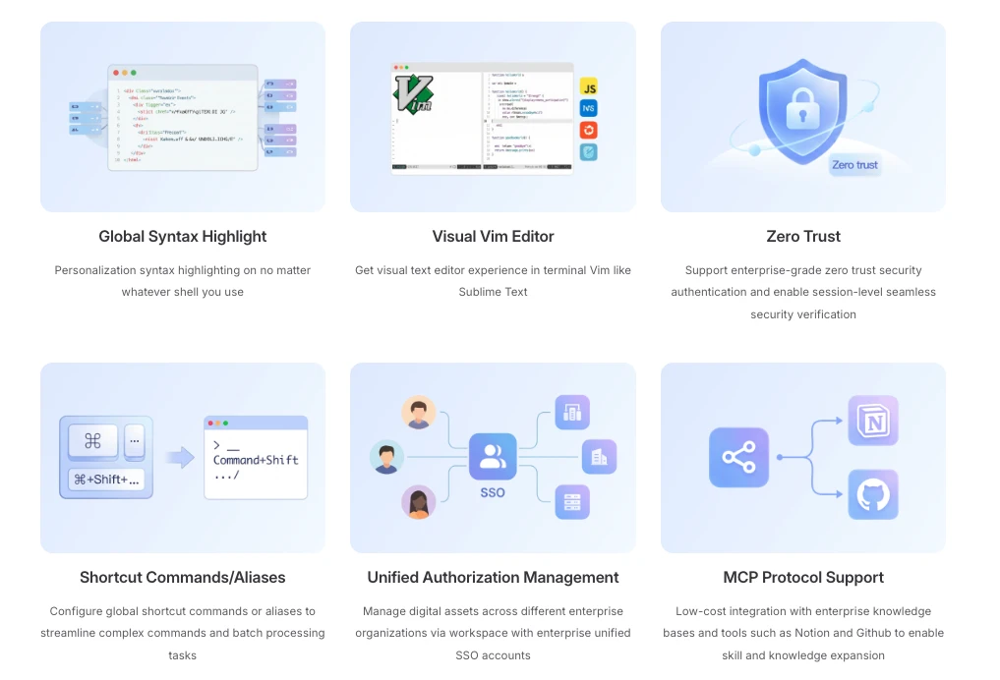

<div align="center">
  <a href="./README_zh.md">中文</a> / <a href="./README.md">English</a> / <a href="./README_ja.md">日本語</a> / Deutsch
</div>
<br>

<p align="center">
  <a href="https://www.tbench.ai/leaderboard/terminal-bench/1.0"></a>
  <a href="https://aws.amazon.com/cn/blogs/china/chaterm-aws-kms-envelope-encryption-for-zero-trust-security-en/"></a>
  <a href="https://landscape.cncf.io/?item=provisioning--automation-configuration--chaterm"></a>
</p>

<p align="center">
  <a href="https://scorecard.dev/viewer/?uri=github.com/chaterm/Chaterm"></a>
  <a href="https://www.bestpractices.dev/projects/12617"></a>
  
  
  <a href="https://x.com/chaterm_ai"></a>
  <a href="https://deepwiki.com/chaterm/Chaterm"></a>
</p>

<p align="center">
  <a href="https://chaterm.ai/download/"></a>
  <a href="https://chaterm.ai/download/"></a>
  <a href="https://chaterm.ai/download/"></a>
  <a href="https://apps.apple.com/us/app/chaterm/id6754307456"></a>
  <a href="https://play.google.com/store/apps/details?id=com.intsig.chaterm.global"></a>
  <a href="https://aws.amazon.com/marketplace/"></a>
  <p align="center">
</p>

## Inhaltsverzeichnis

- [Einführung](#einführung)
- [Warum Chaterm](#warum-chaterm)
- [Hauptfunktionen](#hauptfunktionen)
- [Entwicklungsleitfaden](#entwicklungsleitfaden)
  - [Electron installieren](#electron-installieren)
  - [Installation](#installation)
  - [Entwicklung](#entwicklung)
  - [Build](#build)
- [Chaterm-Dokumentation](https://chaterm.ai/docs/)
  - [Sichere und intelligente Verwaltung von AWS-Private-Subnets mit Chaterm](https://aws.amazon.com/cn/blogs/china/bastion-using-aws-eice-ec2-instance-connect-endpoint-chaterm-implement-subnet-security-intelligent-en/)
  - [Wie die Sicherheitsarchitektur von Chaterm Datensicherheit und Zuverlässigkeit gewährleistet](https://aws.amazon.com/cn/blogs/china/chaterm-aws-kms-envelope-encryption-for-zero-trust-security-en/)
  - [DevOps-Intelligenz mit Chaterm Skills und Qwen-Sprachmodellen verbessern](https://chaterm.ai/blog/posts/agent-skills)
- [Goldsponsoren](#goldsponsoren)
- [Danksagung](#danksagung)
- [Mitwirkende](#mitwirkende)

# Einführung

Chaterm ist ein KI-natives Terminal für die Verwaltung von Infrastruktur und Cloud-Ressourcen. Ingenieurinnen und Ingenieure können damit komplexe Aufgaben wie das Bereitstellen von Diensten, die Fehlersuche und die Problembehebung in natürlicher Sprache erledigen.

Mit einer integrierten Wissensdatenbank auf Expertenniveau und leistungsfähigen Schlussfolgerungsfähigkeiten versteht Chaterm Ihre Geschäftstopologie und Ihre Betriebsziele. Sie müssen sich keine komplizierten Befehle, Syntax oder Parameter merken: Beschreiben Sie Ihr Aufgabenziel einfach in natürlicher Sprache, und Chaterm plant und führt komplexe Vorgänge über mehrere Hosts oder Cluster hinweg selbstständig aus – darunter zentrale Abläufe wie Code-Build, Service-Deployment, Fehlerdiagnose und automatisches Rollback.

Dank Langzeitgedächtnis und Team-Wissensdatenbanken lernt Chaterm das Wissen des Teams und die Gewohnheiten der Nutzer kennen. Ziel ist es, Ihr intelligenter DevOps-Copilot zu sein, mit dem Ingenieure ihre täglichen Aufgaben durch wiederverwendbare Agent Skills effizienter erledigen. Chaterm will die kognitive Einstiegshürde unterschiedlicher Technologie-Stacks senken, damit jede Entwicklerin und jeder Entwickler schnell die Betriebserfahrung und Umsetzungsstärke eines erfahrenen SRE gewinnt.


## Warum Chaterm

Chaterm ist nicht nur ein smarteres Terminal, sondern ein Infrastruktur-Agent.
Es heißt, jeder Agent scheitert immer wieder – aber Chaterm hilft Ihnen, das zu beheben.

- 🤖 Von Befehlen zur Ausführung – Aufgaben beschreiben, die KI plant und führt sie aus

- 🌐 Für echte Infrastruktur gebaut – Server, Kubernetes und Multi-Cluster-Workflows

- 🔁 Wiederverwendbare Agent Skills – Erfahrung in Automatisierung verwandeln

- 🧠 Kontextbewusste Intelligenz – versteht Ihre Systeme, nicht nur Befehle

- 🛡️ Sicher und kontrollierbar – nachvollziehbar, prüfbar und rollback-fähig

## Hauptfunktionen

- 🤖 **KI-Agent**

  Der Agent versteht das Ziel, plant selbstständig und führt Problemanalyse und Ursachenlokalisierung über mehrere Hosts hinweg durch. Dabei schließt er den Kreis automatisch und erledigt auch komplexe Abläufe.

  Jede Operation ist prüfbar und nachvollziehbar und unterstützt ein schnelles Log-Rollback. So wird KI-Automatisierung in Produktionsumgebungen sicherer und zuverlässiger.

- 🧠 **Intelligente Vervollständigung**

  Der Agent kombiniert Nutzergewohnheiten, lokales Gedächtnis und den aktuellen Server-Kontext und empfiehlt die passendsten Befehle. Das macht die Eingabe im Terminal intelligenter und effizienter.

  Das optionale lokale Echo zeigt sichere interaktive Eingaben in SSH-Sitzungen mit hoher Latenz sofort an und unterdrückt das bestätigte Echo vom Remote-Host.

  Unterstützt geräteübergreifende Sitzungssynchronisierung und verringert den Eingabeaufwand auf Mobilgeräten durch Schnellbefehle und Sprachinteraktion – für eine reibungslosere Fernwartung.

- 🧩 **Wissensdatenbank**

  Unterstützt den Import von Fachhandbüchern, internen Dokumenten, Skripten und Whitepapers, um ein persönliches Wartungswissenssystem aufzubauen.

  Chaterm versteht den aktuellen Infrastrukturkontext und ruft relevantes Wissen gezielt ab, um Entscheidungen und Ausführung von Aufgaben zu unterstützen.

  Die hybride Vektor- und Stichwortsuche führt beide Abrufkanäle per RRF-Fusion zu einem einheitlichen Ergebnisranking zusammen.

  Der Abruffortschritt zeigt die Phasen Embedding, Hybridsuche und Reranking live an. Neue Konfigurationen verwenden standardmäßig Qwen-Plus in der China-Edition und Gemini 2.5 Flash in der globalen Edition für schnelleres Reranking.

- ⚡ **Agent Skill**

  Kapselt komplexe Wartungsprozesse in wiederverwendbare KI-Skills und ermöglicht so eine strukturierte, zuverlässige automatisierte Ausführung.

  Hilft Teams, Betriebserfahrung aufzubauen, damit KI in echten Produktionsumgebungen sicher und stabil eingesetzt werden kann.

- 🔌 **Plugin-System**

  Über Plugin-Erweiterungen lassen sich einheitliche Authentifizierung, dynamische Autorisierung und sichere verschlüsselte Verbindungen für Public-Cloud-Server und Kubernetes umsetzen.

  Bietet ein effizienteres Zugriffserlebnis auf Ressourcen und erleichtert die zentrale Verwaltung der Infrastruktur.

- 🗄️ **Datenbank-Arbeitsbereich**

  Verbinden Sie sich mit MySQL, PostgreSQL, SQLite und Oracle, um Schemas zu durchsuchen, Daten abzufragen, DDL einzusehen, Tabellenzeilen zu bearbeiten und datenbankbewusste KI-Unterstützung zu nutzen.

- ⚙️ **Limits pro Modell**

  Legen Sie unter Einstellungen → Modelle das Kontextfenster und die maximale Anzahl an Ausgabetokens für jedes benutzerdefinierte Modell fest. Diese Limits werden sowohl für die Kontextverwaltung als auch für API-Anfragen verwendet.



## Entwicklungsleitfaden

### Electron installieren

```sh
npm i electron -D
```

### Installation

```bash
node scripts/patch-package-lock.js
npm install
```

Meldet Electron eine Nichtübereinstimmung der ABI-Version bei nativen Modulen, bauen Sie die nativen Abhängigkeiten für Electron neu und nicht für die lokale Node.js-Laufzeit:

```bash
npm run rebuild:native
```

Verwenden Sie für Korrekturen an der Electron-Laufzeit nicht `npm rebuild better-sqlite3`; dabei kann das Modul gegen die falsche Node-ABI kompiliert werden.

### Entwicklung

```bash
npm run dev
```

### Build

```bash
# Für Windows
npm run build:win

# Für macOS
npm run build:mac

# Für Linux
npm run build:linux
```

## Goldsponsoren

 

## Danksagung

Chaterm baut auf hervorragenden Open-Source-Projekten auf. Wir danken ausdrücklich:

- **[Cline](https://github.com/cline/cline)** – Teile des KI-Agent-Systems sind von Cline übernommen und angepasst.
- **[RTK](https://github.com/rtk-ai/rtk)** – Filterung der Befehlsausgabe, um den Token-Verbrauch in Agent-Workflows zu senken.

## Mitwirkende

Vielen Dank für Ihren Beitrag!
Weitere Informationen finden Sie im <a href="./CONTRIBUTING.md">Beitragsleitfaden</a>.

<div align=center style="margin-top: 30px;">
  <a href="https://github.com/chaterm/Chaterm/graphs/contributors">
    
  </a>
</div>
